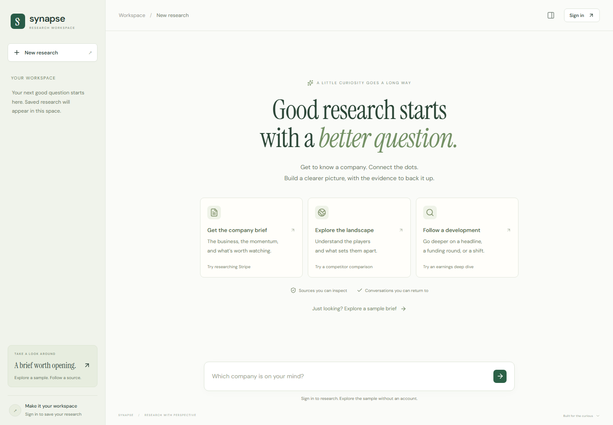
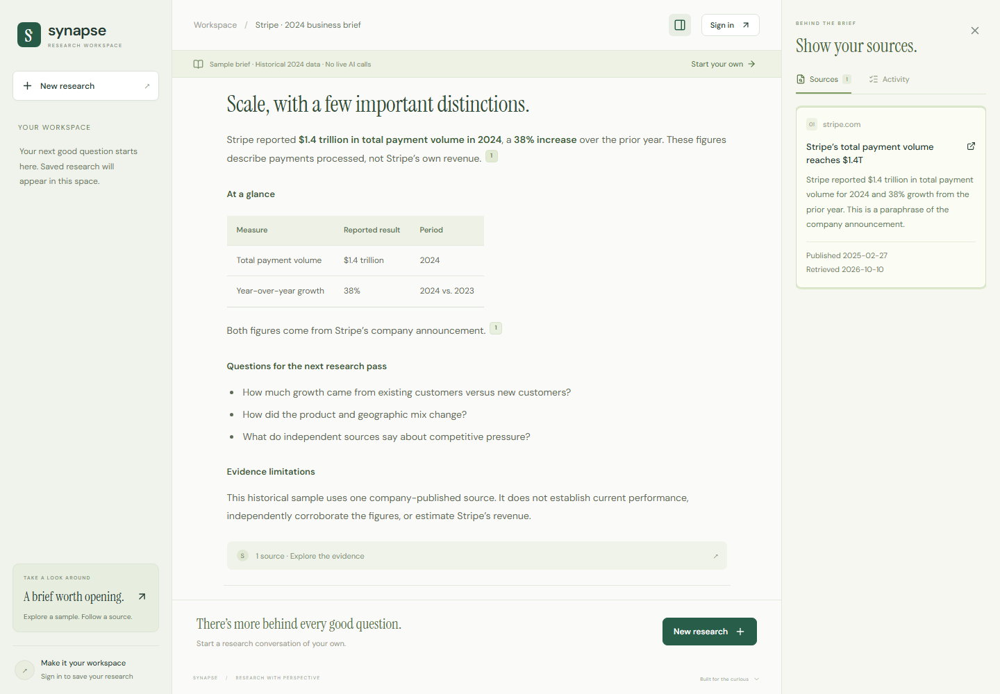
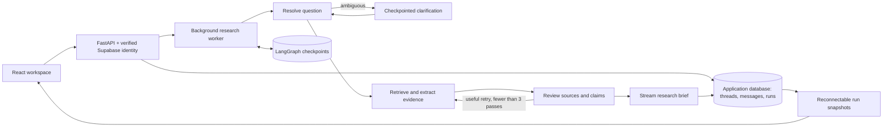

# Synapse · Company Research Agent

Turn company questions into **evidence-backed research briefs**. Ask about a company or compare competitors, inspect the sources behind each claim, continue a saved conversation, and watch the research workflow as it runs.



> **Try the sample:** after starting the app, open [`/?demo=1`](http://localhost:5173/?demo=1). No signup or API keys required — it uses labelled historical 2024 Stripe data.

## Features

- Research a company or comparison, then ask contextual follow-ups
- Inline citations with retrieved excerpts, publication dates (when available), and source URLs
- Live research stages and incremental report streaming, with a persisted activity log
- Saved conversations that survive refresh and backend restart — search, rename, archive, restore, or delete threads
- Per-conversation unsent drafts, retry for failed requests, and stop for in-flight runs
- Export briefs as Markdown with usable source links
- Mobile-friendly layout with keyboard controls and reduced-motion support



## Stack

| Layer | Tech |
| --- | --- |
| Frontend | React 19, Vite, TypeScript, Supabase Auth |
| API | FastAPI, SSE run snapshots |
| Agent | LangGraph + Gemini + Tavily search |
| Storage | SQLite (local) or Supabase/Postgres (cloud) |

## Architecture



Application messages are the history of record. Checkpoints hold agent execution state. Sources are structured JSON on persisted reports/runs — not reconstructed from generated prose. Ownership is checked before every thread access (including SSE and cancellation). Runs belong to the server: closing a tab does not cancel research.

See [docs/architecture.md](docs/architecture.md) for engineering decisions and guarantees.

## Quick start

**Requirements:** Python 3.12+ and Node.js 22+ (pnpm recommended).

### 1. Backend

```bash
python -m venv .venv
# Windows: .venv\Scripts\Activate.ps1
# macOS/Linux: source .venv/bin/activate
pip install -r requirements-dev.txt
cp .env.example .env
cp frontend/.env.example frontend/.env.local
```

Add your Gemini, Tavily, and Supabase keys to `.env` / `frontend/.env.local`.  
**Never** put backend service keys in frontend env vars.

Local SQLite (does not change cloud URLs in `.env`):

```bash
# Windows PowerShell
$env:APP_DATABASE_URL='sqlite:///research.db'
$env:CHECKPOINT_DATABASE_URL='sqlite:///checkpoints.db'
python -m uvicorn backend.main:app --host 127.0.0.1 --port 8000
```

```bash
# macOS / Linux
export APP_DATABASE_URL='sqlite:///research.db'
export CHECKPOINT_DATABASE_URL='sqlite:///checkpoints.db'
python -m uvicorn backend.main:app --host 127.0.0.1 --port 8000
```

### 2. Frontend

```bash
cd frontend
pnpm install   # or: npm install
pnpm dev       # or: npm run dev
```

Open [http://localhost:5173](http://localhost:5173). Vite proxies `/api` to port `8000` (override with `API_PROXY_TARGET`). The no-signup sample works without provider keys; live research and saved chats need Supabase.

### Supabase / Postgres

```bash
python scripts/migrate.py
python scripts/import_legacy.py   # stop the API first; backs up existing owned transcripts
python -m uvicorn backend.main:app --host 127.0.0.1 --port 8000 --workers 1
```

`APP_ENV=production` requires PostgreSQL for both stores and fails closed if persistence is unavailable. `APP_DATABASE_URL` and `CHECKPOINT_DATABASE_URL` override `DATABASE_URL` when set.

## Project layout

```
backend/     FastAPI app, auth, store, run worker
frontend/    React workspace UI
graph/       LangGraph research workflow
tools/       Search / extraction helpers
evals/       Offline & live evaluation harness
docs/        Architecture, deployment, walkthrough
supabase/    SQL / project config
scripts/     Migrations and legacy import
tests/       Backend tests
```

## Verification

```bash
python -m pytest tests -q
python -m evals.run --offline --output evals/offline-smoke.json
cd frontend
pnpm test
pnpm build
pnpm exec playwright install chromium
pnpm test:e2e
```

Backend tests use isolated databases and fake providers. Browser tests intercept auth/API traffic. Live evals hit real providers — see [docs/verification.md](docs/verification.md) and [evals/README.md](evals/README.md).

## Evaluation

```bash
python -m evals.run --limit 5
```

Compares the multi-step agent workflow against a single synthesis pass over the same retrieved evidence (uses configured provider quota). Results cover latency, model calls, tokens, citation-ID validity, and a human scoring rubric. Optional cost estimates via `INPUT_USD_PER_MILLION` / `OUTPUT_USD_PER_MILLION` (search fees excluded).

**Caveat:** evidence review is LLM-based. A valid citation ID does not guarantee the source supports the claim. The product makes sources inspectable rather than claiming independent fact verification.

## Deployment

- [Dockerfile](Dockerfile) — serves built frontend + API from one origin
- [render.yaml](render.yaml) — single-instance Render blueprint
- [docs/deployment.md](docs/deployment.md) — host env setup

Public Supabase frontend values are build args; the service role key stays server-side only.

## API

| Endpoint | Purpose |
| --- | --- |
| `GET /api/health` | Storage readiness and research availability |
| `GET /api/threads` | Owned threads (`q`, `archived`, `limit`, `offset`) |
| `GET /api/threads/{id}/messages` | Saved messages and research runs |
| `PATCH /api/threads/{id}` | Rename, archive, restore |
| `DELETE /api/threads/{id}` | Delete history, sources, runs, and checkpoints |
| `POST /api/chat` | Persist a message and accept a background run (`request_id` required) |
| `GET /api/runs/{id}` | Durable run snapshot |
| `GET /api/runs/{id}/events` | SSE snapshots (reconnectable) |
| `POST /api/runs/{id}/cancel` | Cooperative cancellation |

Submit once via `POST /api/chat`, then subscribe to the returned run ID. Interactive docs: `/docs`.

## Docs

| Doc | Topic |
| --- | --- |
| [Architecture](docs/architecture.md) | Persistence, idempotency, cancellation |
| [Deployment](docs/deployment.md) | Production hosting |
| [Walkthrough](docs/walkthrough.md) | Product / agent flow |
| [Verification](docs/verification.md) | Test results and limitations |

## License

This project is provided as-is for demonstration and assignment use unless otherwise stated by the repository owner.
