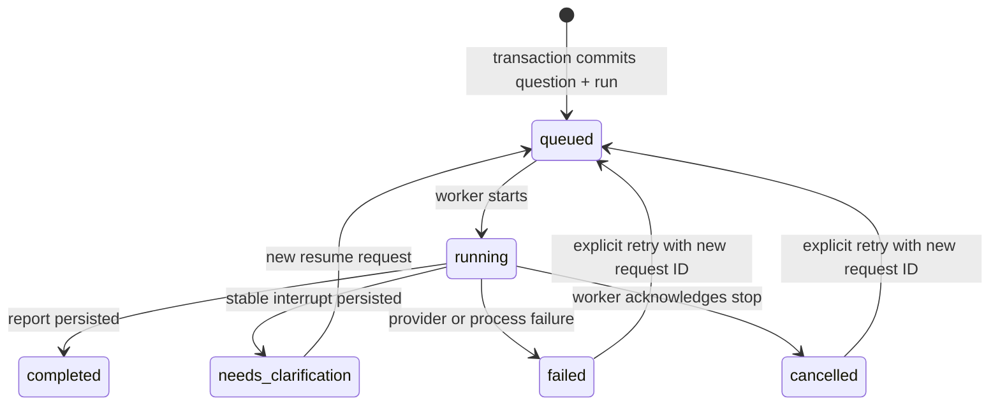

# Engineering decisions

## Conversation history and execution state

`threads` owns the user-visible conversation. `messages` stores stable IDs, roles, content, timestamps, delivery status, report sources and run associations. `research_runs` stores prompts, idempotency keys, statuses, progress events, draft output, source metadata, errors and usage. Checkpoints store graph memory and the next executable step. Reads never translate a database exception into an empty conversation.

The API serializes submissions per user with a PostgreSQL advisory transaction lock (SQLite uses an immediate transaction). The thread ID must belong to the authenticated user. Idempotency is scoped to the user and includes the prompt, thread, resume flag and retry target. Only one active run per thread is accepted. Daily and concurrent-user caps bound basic usage; defaults are 50/day and two active runs. These are deployment configuration values, not billing controls.

Thread IDs remain UUIDs for compatibility with old checkpoints. All graph access is behind application ownership checks; knowing an ID is insufficient. Supabase service credentials and direct database connections bypass RLS, so API checks are mandatory. Application tables are revoked from browser roles. Checkpoint tables are also revoked from Supabase browser roles at setup.

## Run lifecycle

Provider calls have timeouts and bounded retries. A stop request keeps the active-run lock until the worker acknowledges it; a result arriving after cancellation is not published as a completed report. A checkpoint completed immediately before a process failure can be recovered by retry without appending the user's question twice. The next independent turn clears previous per-run results before research begins.

Each SSE event is a persisted snapshot, so a new subscriber recovers the entire draft, stage log and state. This uses more bytes than token-only events but makes reconnect logic simple. Draft writes are batched at roughly 250ms while tokens are arriving. Tokens before the first persisted batch may be lost on a hard process crash; the checkpoint remains the recovery mechanism.

## Scope and operational boundaries

- One API process/instance owns the in-process worker pool. A database/file owner lock rejects additional owners. Horizontal scaling needs a durable queue, worker leases, and distributed cancellation. A server restart exposes an explicit retry rather than claiming uninterrupted execution.
- Use stop-before-start deployment for the single-owner service. A blue/green replacement cannot acquire the lock while the old instance is alive.
- A database outage while persisting a failure may leave a run marked running until process restart/recovery. Database observability and a lease-based external worker would be the next operational improvement.
- Checkpoint deletion and application deletion span separate database connections. Checkpoints are deleted first; errors preserve the visible conversation. These two deletions are not a distributed atomic transaction.
- Full messages stay in application storage; the model receives bounded recent history. Arbitrarily long conversations may need explicit semantic summaries later.
- Search/validation examines snippets, not complete documents. Domain matching helps find company sources, but does not verify ownership or factual accuracy. Source dates are labelled unknown when absent.
- API thread lists support pagination. The initial UI loads 100 matching threads; large-workspace pagination is a follow-up.
- Frontend drafts use browser session storage and are cleared on sign-out; they are not synchronized between devices.

## Frontend structure

`useAuth` owns session state. Account identity keys the workspace so changing accounts unmounts requests and conversation data. `useWorkspace` owns API reads, per-request cancellation, selected-thread identity, and run subscriptions. Stale request results cannot replace another selected thread. `Composer`, `Report`, `Sidebar`, and `EvidencePanel` contain focused presentation behavior. The URL identifies the active thread; browser navigation and refresh restore it.
